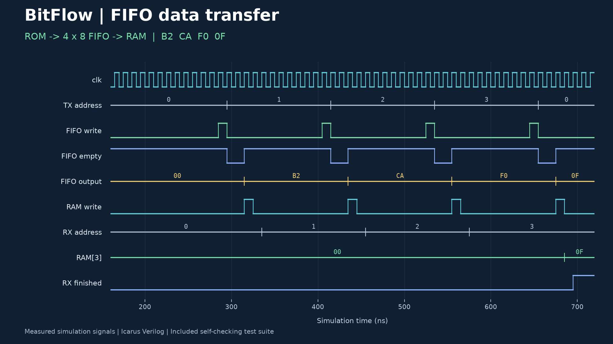

# BitFlow: Digital Communication System with FIFO Buffering

Academic team project at Shenkar, 2026.

A modular digital system transfers four 8-bit words from ROM to RAM. Includes a serial LSB-first baseline, a FIFO extension, the course report and automated tests.



## Two data paths

```text
Serial baseline: ROM -> TBUF -> serial TX -> RBUF -> RAM
FIFO extension:  ROM -> TX word-complete event -> 4 x 8 FIFO -> RX -> RAM
```

The FIFO extension follows the report's Figure 19: `inc_adrs_tx` writes the current `rom_dout` byte into the FIFO. The serial TX still runs, but the extended receive path reads whole bytes from the FIFO; it does not deserialize `tx_data`. Both versions share one clock. This is not a UART or an asynchronous clock-domain crossing design.

The default ROM bytes are **B2, CA, F0, 0F**, matching the final RAM values visible in Figure 23. TX waits for readiness before each word, reads the ROM, loads TBUF, shifts eight bits and advances the address. The serial RX captures valid bits LSB first and writes each completed byte to RAM.

The FIFO has registered output, two pointers, an occupancy counter and full/empty flags. RX uses separate READ and WRITE cycles so the registered FIFO result is available before writing RAM. Four words are transferred per reset.

## Run

Install Icarus Verilog and run from the repository root:

```sh
make test
```

Tests cover FIFO ordering and pointer wraparound, full/empty boundaries, simultaneous operations, deterministic randomized traffic, serial bit order, both ROM-to-RAM paths, reset during transfer and repeatable restart. VCD waveforms are generated in `build/`.

For ModelSim/Questa: run `vsim -c -do simulate.do` from the repository root. The script is supplied; the current test run used Icarus.

## FIFO boundary policy

Requests are accepted using **pre-edge** full/empty state, matching Figure 18. At full with both requests asserted, only the read is accepted. At empty with both asserted, only the write is accepted. At intermediate occupancy, both are accepted and the count is unchanged. Rejected reads leave `dout` unchanged. The top-level transmitter emits exactly four words, which fit the four-entry FIFO; continuous streaming would require additional backpressure.

## Materials and verification

- [Reviewed project report](docs/report.pdf): current technical explanation and clarifications.
- [Archived course report](docs/course-report.pdf).
- [Implementation and test notes](docs/IMPLEMENTATION.md).
- [Latest test results](docs/verification.txt).
- [Original course simulation image](assets/simulation.png).

The release contains runnable RTL, self-checking testbenches and simulation scripts. The course report records ModelSim results; current verification plots come from the included test suite. No hardware, maximum frequency, baud rate, throughput gain or asynchronous FIFO result is claimed.

## Team

Matan Ratzabi, Batel Bitton and Eden Eli.

**Tools:** Verilog/SystemVerilog, Icarus Verilog, ModelSim (course report), FSMs, shift registers, ROM/RAM and synchronous FIFO buffering.

To regenerate the simulation chart after testing: `python3 -m pip install -r tools/requirements.txt`, then `python3 tools/plot_waveforms.py`.
