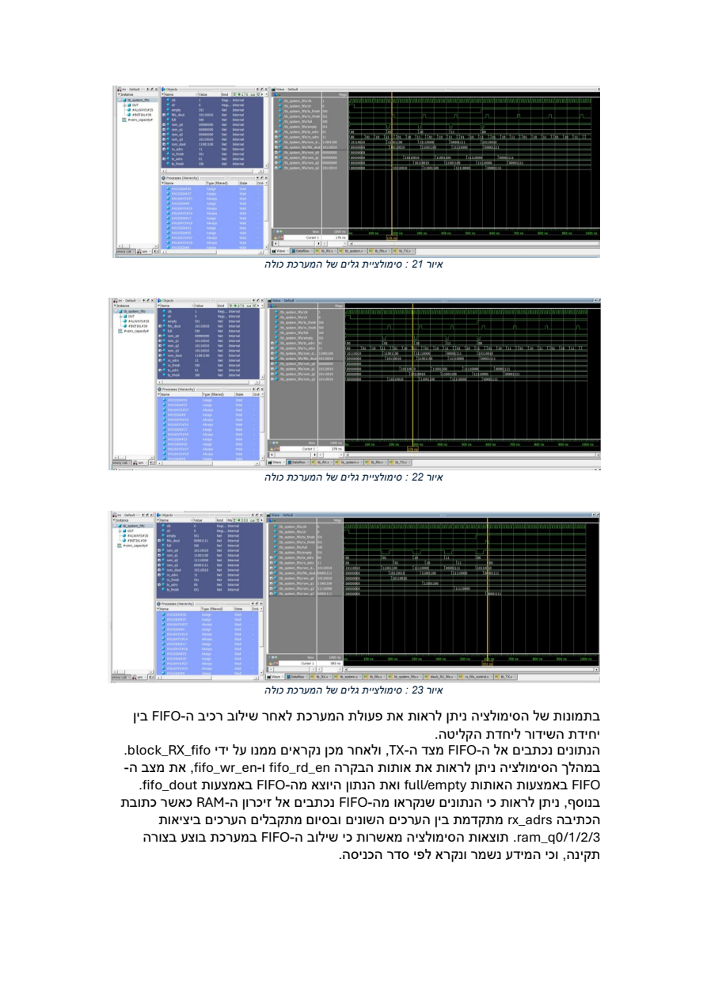

# BitFlow: Digital Communication System with FIFO Buffering

Academic team project at Shenkar, 2026.

A modular Verilog communication system that transfers four 8-bit words from a transmit-side ROM to receive-side RAM. The baseline design uses serial, LSB-first transmission; an extension adds a **4-entry, 8-bit FIFO** between the transmit and receive paths.

## Architecture

```text
ROM -> TX -> FIFO -> RX -> RAM
```

The baseline TX contains an FSM controller, address register, ROM and shift register. The RX contains a controller, address register, receive buffer and RAM. The FIFO extension uses read/write pointers, an occupancy counter, and full/empty flags.

## Verification and debugging

The supplied report documents TX, RX, system and FIFO testbenches and ModelSim waveform inspection. Reported fixes include:

- Reading from the FIFO only when it is not empty.
- Asserting write enable for each testbench input word.
- Separating READ and WRITE states so FIFO output is available before RAM write-back.

The report shows all four words arriving in RAM in input order. It does not establish asynchronous clock-domain crossing, exhaustive overflow testing, a baud rate or a measured throughput improvement.



## Materials

- [Project report](docs/report.pdf), with the original identification-number cover omitted and annotations removed.
- RTL and testbench source files have not yet been supplied, so simulations cannot be independently rerun from this package.

## Team

Matan Ratzabi, Batel Bitton and Eden Eli.

**Tools:** Verilog, ModelSim, finite-state machines, shift registers, ROM/RAM, FIFO buffering.
